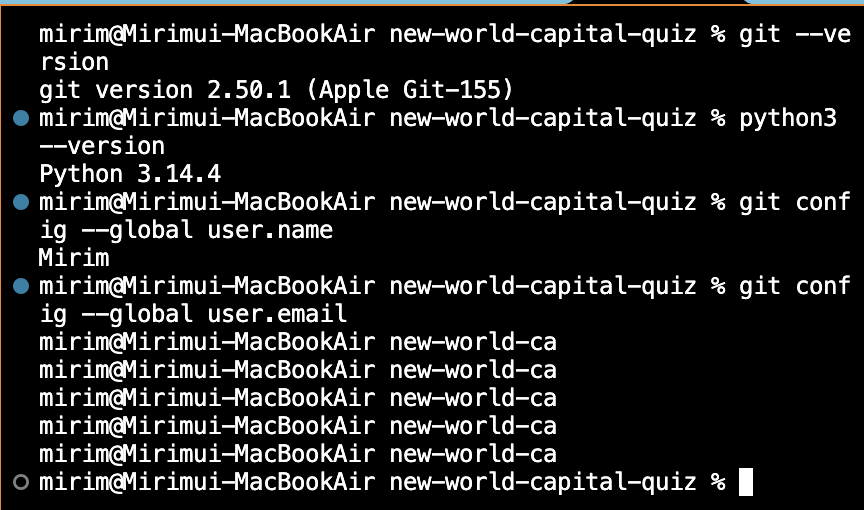
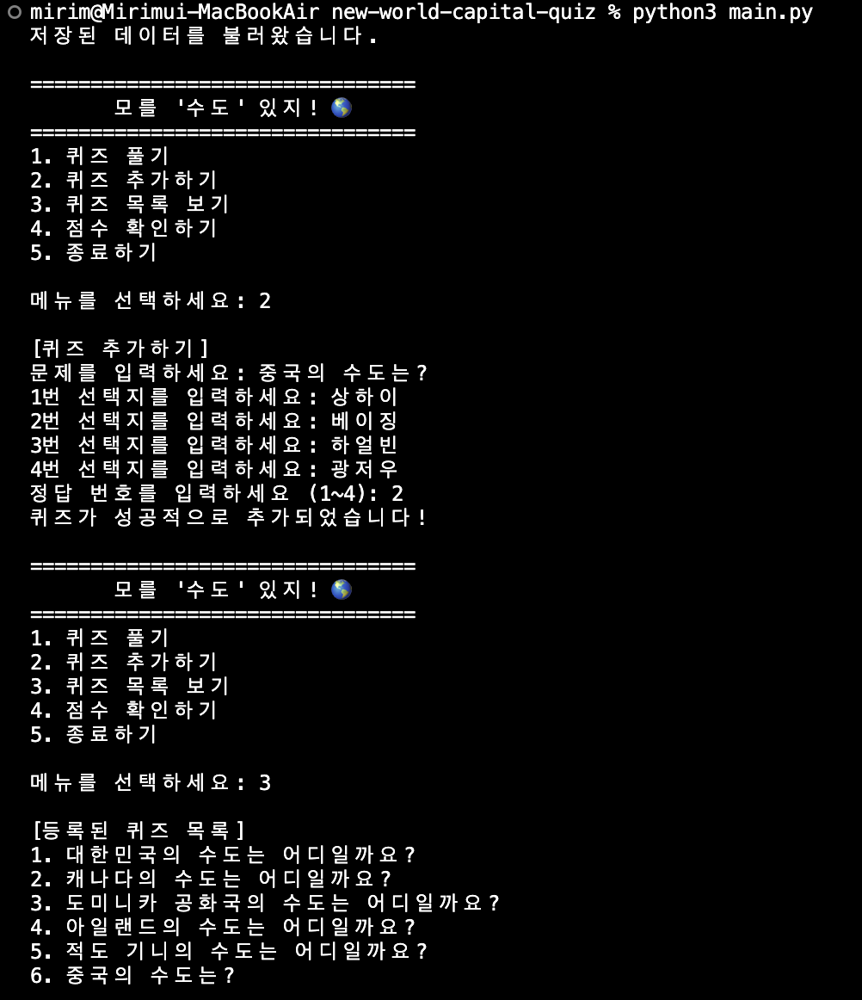
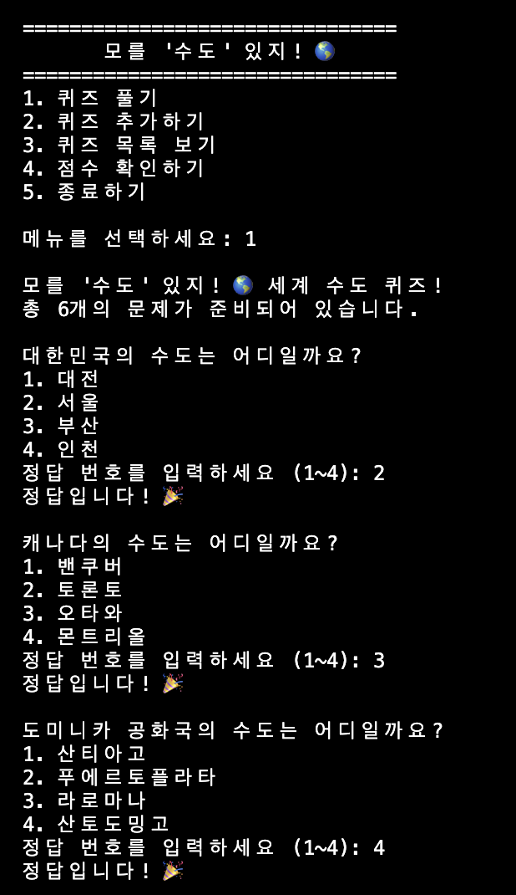
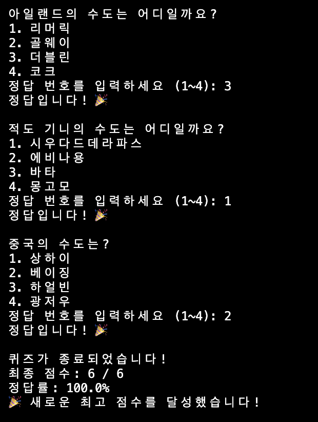
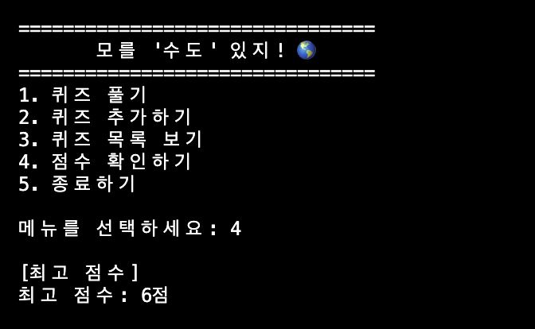
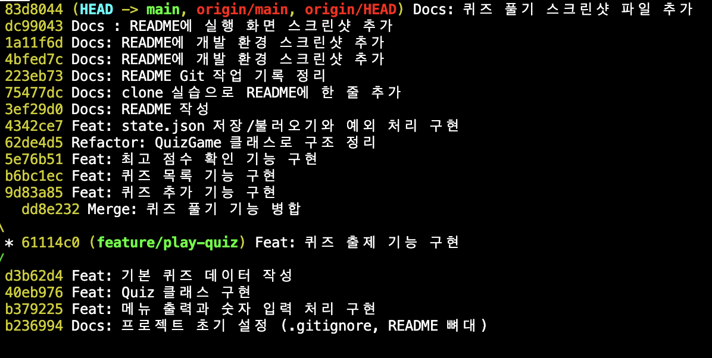

# 2주차 미션 - 컴퓨터에게 명령 내리는 말(파이썬) 처음 배우기

# 📝 Python Quiz Game

## 목차
1. [프로젝트 개요](#1-프로젝트-개요)
2. [퀴즈 주제 및 선정 이유](#2-퀴즈-주제-및-선정-이유)
3. [개발 환경](#3-개발-환경)
4. [실행 방법](#4-실행-방법)
5. [기능 목록](#5-기능-목록)
6. [파일 구조](#6-파일-구조)
7. [데이터 파일 설명](#7-데이터-파일-설명)
8. [Git 작업 기록](#8-git-작업-기록)

---

## 1. 프로젝트 개요

Python을 활용하여 터미널 환경에서 실행되는 퀴즈 게임을 개발하는 프로젝트입니다.

사용자는 메뉴를 통해 퀴즈 풀기, 퀴즈 추가, 퀴즈 목록 확인, 최고 점수 확인 등의 기능을 이용할 수 있습니다.

Python의 기본 문법과 객체 지향 프로그래밍을 활용하여 프로그램을 구현하고, JSON 파일을 통해 퀴즈 데이터와 최고 점수를 저장하여 프로그램을 종료한 후에도 데이터를 유지할 수 있도록 합니다.

또한 Git과 GitHub를 활용하여 프로젝트의 변경 이력을 관리하고, 브랜치 생성 및 병합 등의 버전 관리 과정을 학습합니다.

## 2. 퀴즈 주제 및 선정 이유

**퀴즈 제목:** 모를 '수도' 있지! 세계 수도 맞히기 🌎

**주제 및 선정 이유:**

'모를 수도 있지'라는 말이 재미있고 친근하게 느껴져서 이 제목에 어울리는 퀴즈를 만들어 보고 싶었습니다. '수도'라는 단어의 중의적인 의미를 활용한 제목인 만큼, 세계 여러 나라의 수도를 맞히는 퀴즈를 주제로 선정하였습니다.

## 3. 개발 환경

- **Programming Language:** Python 3.14.4
- **Development Tool:** Visual Studio Code
- **Version Control:** Git, GitHubg
- **Data Storage:** JSON
- **Library:** Python 표준 라이브러리 사용 (외부 라이브러리 사용하지 않음)
<details>
<summary>개발 환경 설정 스크린샷 보기</summary>



</details>

## 4. 실행 방법

1. Python 3.10 이상이 설치되어 있어야 합니다. (외부 라이브러리는 필요하지 않습니다.)
2. 저장소를 내려받습니다.

```bash
git clone https://github.com/mirimgo/world-capital-quiz.git
cd world-capital-quiz
```

3. 프로그램을 실행합니다.

```bash
python3 main.py
```

Windows에서는 `python main.py`로 실행합니다.

## 5. 기능 목록

| 기능 | 설명 |
| --- | --- |
| 메뉴 | 번호를 입력해 기능을 선택하고, 종료할 수 있습니다. |
| 퀴즈 풀기 | 저장된 퀴즈를 차례로 출제하고 정답/오답을 알려 주며, 마지막에 점수와 정답률을 보여 줍니다. |
| 퀴즈 추가 | 문제, 선택지 4개, 정답 번호를 입력해 새 퀴즈를 등록합니다. |
| 퀴즈 목록 | 등록된 퀴즈의 문제를 번호와 함께 보여 줍니다. |
| 점수 확인 | 최고 점수를 보여 주며, 퀴즈를 풀 때마다 최고 점수와 비교해 갱신합니다. |
| 데이터 저장 | 퀴즈와 최고 점수를 `state.json`에 저장하고 다시 불러옵니다. |

**입력 및 예외 처리**

- 입력 앞뒤 공백을 제거하고 처리합니다.
- 빈 입력, 숫자가 아닌 입력, 허용 범위 밖의 숫자를 입력하면 안내 메시지를 출력하고 다시 입력받습니다.
- 실행 중 Ctrl+C(`KeyboardInterrupt`)나 입력 스트림 종료(`EOFError`)가 발생해도 안내 메시지를 출력하고, 가능한 범위에서 저장한 뒤 안전하게 종료합니다.
- `state.json`이 없으면 기본 퀴즈로 시작하고, 손상되었으면 안내 메시지를 출력한 뒤 기본 퀴즈로 복구합니다.

### 실행 화면

<details>
<summary>📸 퀴즈 추가 화면 보기</summary>



</details>

<details>
<summary>퀴즈 풀기 화면 보기</summary>





</details>

<details>
<summary>최고 점수 확인 화면 보기</summary>



</details>

## 6. 파일 구조

```
world-capital-quiz/
├── main.py          # 프로그램 코드 (Quiz, QuizGame 클래스)
├── capitals.json    # 기본 퀴즈의 나라별 정답(수도)
├── cities.json      # 기본 퀴즈의 나라별 오답 선택지 3개
├── state.json       # 퀴즈와 최고 점수 저장 파일 (실행 시 자동 생성, Git 제외)
├── .gitignore
└── README.md
```

## 7. 데이터 파일 설명

### state.json

- **경로:** 프로젝트 루트(`main.py`와 같은 폴더)
- **역할:** 등록된 퀴즈와 최고 점수를 저장합니다. 프로그램을 처음 실행하면 기본 퀴즈로 자동 생성되고, 손상된 경우 기본 퀴즈로 복구됩니다. 실행할 때마다 내용이 바뀌는 파일이라 `.gitignore`에 추가하여 Git에는 올리지 않습니다.
- **인코딩:** UTF-8
- **스키마:**

```json
{
    "quizzes": [
        {
            "question": "대한민국의 수도는 어디일까요?",
            "choices": ["인천", "서울", "부산", "대전"],
            "answer": 2
        }
    ],
    "best_score": 3
}
```

| 키 | 설명 |
| --- | --- |
| `quizzes` | 퀴즈 목록 |
| `question` | 문제 |
| `choices` | 선택지 4개 |
| `answer` | 정답 번호 (1~4) |
| `best_score` | 최고 점수 (아직 퀴즈를 풀지 않았다면 `null`) |

### capitals.json / cities.json

- `capitals.json`: `{ "나라": "수도" }` 형태로, 기본 퀴즈의 정답을 담고 있습니다.
- `cities.json`: `{ "나라": ["오답1", "오답2", "오답3"] }` 형태로, 기본 퀴즈의 오답 선택지를 담고 있습니다.
- `state.json`이 없을 때 이 두 파일로 기본 퀴즈 5개(대한민국, 캐나다, 도미니카 공화국, 아일랜드, 적도 기니)를 만듭니다.

## 8. Git 작업 기록

기능 단위로 커밋하고, 커밋 메시지에 작업 내용을 드러냈습니다.

| 순서 | 커밋 메시지 |
| --- | --- |
| 1 | Docs: 프로젝트 초기 설정 (.gitignore, README 뼈대) |
| 2 | Feat: 메뉴 출력과 숫자 입력 처리 구현 |
| 3 | Feat: Quiz 클래스 구현 |
| 4 | Feat: 기본 퀴즈 데이터 작성 |
| 5 | Feat: 퀴즈 출제 기능 구현 (`feature/play-quiz` 브랜치) |
| 6 | Merge: 퀴즈 풀기 기능 병합 |
| 7 | Feat: 퀴즈 추가 기능 구현 |
| 8 | Feat: 퀴즈 목록 기능 구현 |
| 9 | Feat: 최고 점수 확인 기능 구현 |
| 10 | Refactor: QuizGame 클래스로 구조 정리 |
| 11 | Feat: state.json 저장/불러오기와 예외 처리 구현 |
| 12 | Docs: README 작성 |
| 13 | Docs: clone 실습으로 README에 한 줄 추가 |

<details>
<summary>git log --oneline --graph 결과 보기</summary>



</details>

**사용한 Git 명령어:** `init`, `add`, `commit`, `push`, `checkout`, `merge`, `pull`, `clone`
> clone/pull 실습: 복제한 저장소에서 추가한 줄입니다.